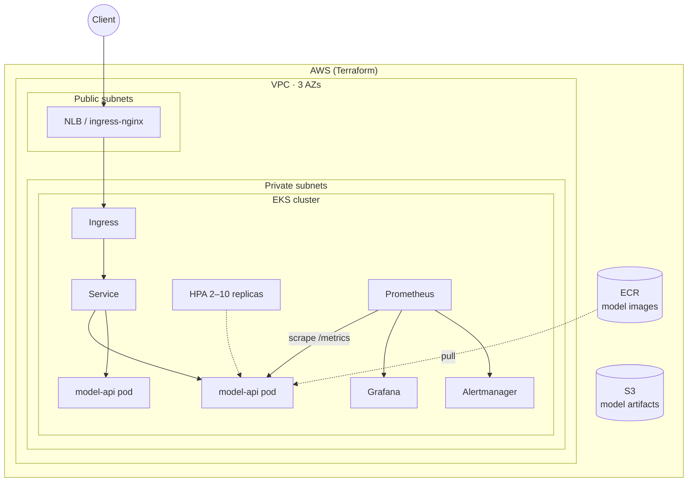

# Kubernetes + Terraform ML Infrastructure


Infrastructure as Code for running ML model APIs in production on **AWS EKS**. **Terraform** provisions the cloud (VPC, EKS, ECR, S3). **Kubernetes manifests** deploy the model with autoscaling and zero-downtime rollouts. **kube-prometheus-stack** adds metrics, dashboards and alerts.

It deploys the image built by [mlops-end-to-end-pipeline](https://github.com/Muhammad-HamzaShamsi/mlops-end-to-end-pipeline), but any HTTP model server with `/health` and `/metrics` endpoints works.

## Architecture



## What's inside

| Layer | Tooling | Highlights |
|-------|---------|------------|
| **Network** | `terraform-aws-modules/vpc` | 3 AZs, private nodes, NAT (single in dev, one per AZ in prod), ELB subnet tags |
| **Compute** | `terraform-aws-modules/eks` v20 | Managed node group (Spot in dev/staging, On-Demand in prod), core add-ons, Pod Identity |
| **Registry** | ECR | Immutable tags, scan on push, lifecycle policy keeping the last 20 images |
| **Storage** | S3 | Versioned, encrypted, public access blocked, for model artifacts / MLflow |
| **Workload** | Kustomize | Rolling updates with `maxUnavailable: 0`, probes, resource limits, non-root and read-only filesystem, zone spreading, PDB |
| **Scaling** | HPA v2 | CPU-based, 2–10 replicas, 5-minute scale-down stabilisation |
| **Observability** | kube-prometheus-stack | ServiceMonitor, PrometheusRule alerts (API down, p95 latency, error rate), Grafana |
| **CI** | GitHub Actions | `terraform fmt` / `validate`, `kubeconform` schema validation (including CRDs), ShellCheck |

## Repository layout

```
k8s-terraform-ml-infra/
├── terraform/
│   ├── versions.tf          # providers, optional S3 remote state
│   ├── variables.tf         # project, environment, region, node sizing
│   ├── main.tf              # VPC, EKS, ECR, S3
│   ├── outputs.tf
│   └── terraform.tfvars.example
├── k8s/                     # Kustomize base for the model API
│   ├── namespace.yaml  deployment.yaml  service.yaml
│   ├── hpa.yaml  pdb.yaml  ingress.yaml
│   └── kustomization.yaml
├── monitoring/
│   ├── kube-prometheus-stack-values.yaml
│   ├── servicemonitor.yaml
│   └── alerts.yaml
├── scripts/
│   ├── bootstrap.sh         # terraform apply → helm add-ons → deploy
│   └── destroy.sh
└── .github/workflows/infra-ci.yml
```

## Getting started

**Prerequisites:** an AWS account and credentials (`aws configure`), plus `terraform >= 1.6`, `kubectl`, `helm`.

```bash
git clone https://github.com/Muhammad-HamzaShamsi/k8s-terraform-ml-infra.git
cd k8s-terraform-ml-infra
cp terraform/terraform.tfvars.example terraform/terraform.tfvars   # adjust region/sizing

bash scripts/bootstrap.sh   # ~15–20 min: VPC + EKS + add-ons + model API
```

Step by step instead:

```bash
cd terraform && terraform init && terraform plan && terraform apply
$(terraform output -raw configure_kubectl)
cd .. && kubectl apply -k k8s
kubectl -n ml-serving get pods,svc,hpa
```

Test the deployed API:

```bash
HOST=$(kubectl -n ingress-nginx get svc ingress-nginx-controller -o jsonpath='{.status.loadBalancer.ingress[0].hostname}')
curl http://$HOST/health
```

Open Grafana:

```bash
kubectl -n monitoring port-forward svc/monitoring-grafana 3000:80   # http://localhost:3000
```

## Environments and cost

`environment` changes behaviour for cost against resilience:

| Setting | dev / staging | prod |
|---|---|---|
| NAT gateways | 1 shared | 1 per AZ |
| Node capacity | Spot | On-Demand |
| ECR / S3 `force_delete` | enabled | disabled |

> ⚠️ EKS, NAT gateways and load balancers cost money. Run `bash scripts/destroy.sh` when you are done experimenting.

## Roadmap

- [ ] GitOps delivery with Argo CD
- [ ] Karpenter for node autoscaling
- [ ] External Secrets + AWS Secrets Manager
- [ ] Canary releases with Argo Rollouts

## License

MIT © Muhammad Hamza Shamsi
